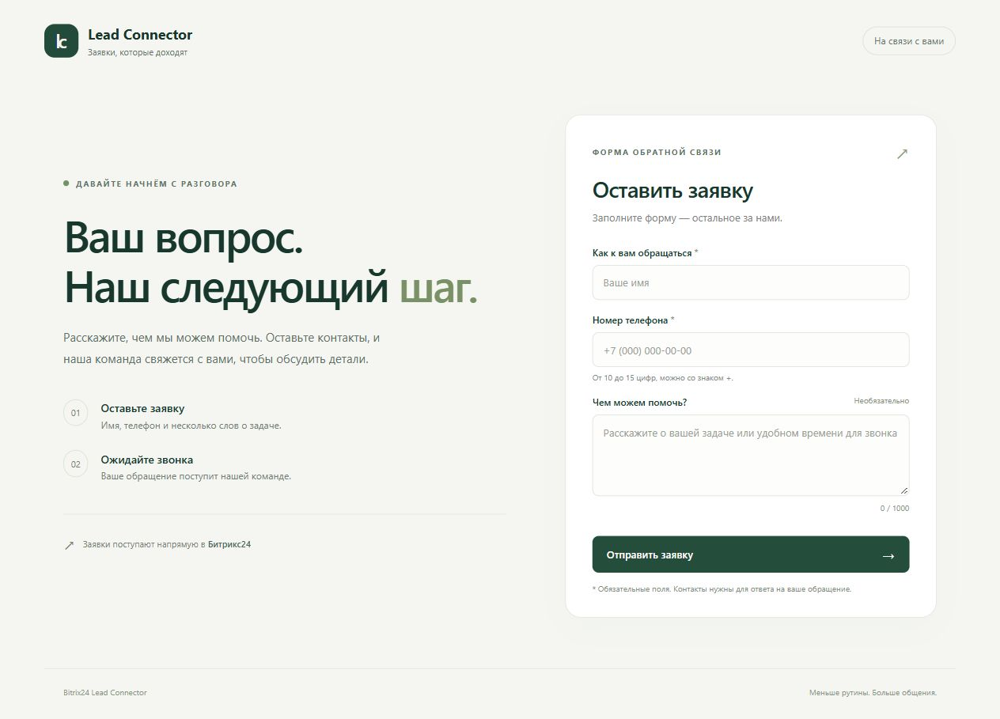
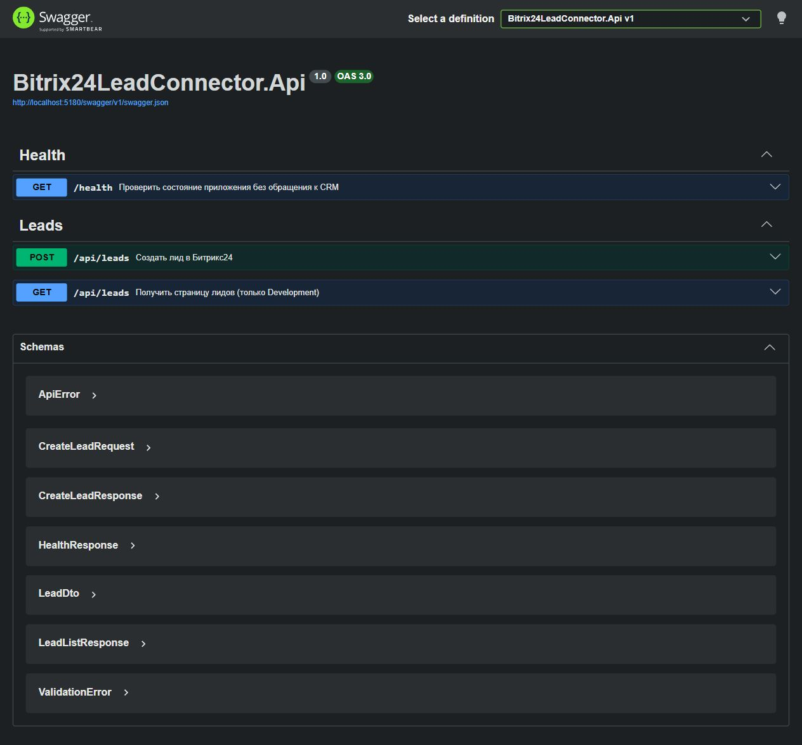
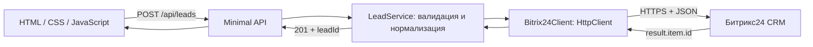

# Bitrix24 Lead Connector

Учебное веб-приложение на **C# / .NET 10 / ASP.NET Core Minimal API**, которое передаёт заявки с сайта в Битрикс24 через входящий вебхук. Менеджеру больше не нужно вручную переносить имя, телефон и комментарий из формы в CRM.

Создание выполняется через `crm.item.add` с `entityTypeId = 1`; ответ содержит настоящий ID из `result.item.id`. В Development доступен список лидов через `crm.item.list`. Приложение не использует БД и не имитирует успешное создание лида.

## Интерфейс





Скриншоты формы и Swagger показывают локальное приложение; они не подтверждают реальное подключение к CRM. Для демонстрации реального лида выполните [сценарий проверки](docs/DEMO.md).

## Возможности

- Форма с проверкой полей, блокировкой повторного нажатия, индикацией отправки и сообщениями об ошибках.
- Серверная валидация и нормализация телефона; неверная заявка не отправляется в CRM.
- Асинхронный типизированный `HttpClient` через DI, `CancellationToken`, тайм-аут 10 секунд.
- Обработка HTTP-ошибок, ошибок в JSON даже при HTTP 200, неверного JSON и ответа без ID.
- Пагинация списка лидов через `start` / `nextStart`; данные читаются из CRM без локального хранения.
- Безопасные журналы `ILogger`, конфигурация через Options и проверка настроек при запуске.
- До 5 отправок в минуту на IP, ограничение JSON 8 КБ, `/health` без обращения к CRM.
- Swagger UI и чтение лидов доступны **только в Development**.
- xUnit-тесты интеграции с подменой `HttpMessageHandler`, API-тесты и проверки frontend на Node.js.

## Архитектура



`GET /api/leads` использует ту же цепочку в Development. [Подробности архитектуры](docs/ARCHITECTURE.md) · [Контракты API](docs/API.md) · [Матрица тестов](docs/TESTING.md).

## Предварительные требования

1. .NET 10 SDK. Локальная разработка проверена на установленном .NET SDK 10.0.300-preview; CI использует .NET 10 SDK из ветки `10.0.x`.
2. Собственный тестовый портал Битрикс24 с доступом к REST API.
3. Классический режим CRM с лидами.
4. Пользователь с правами создавать и читать лиды и входящий вебхук со scope `crm`.
5. Node.js 22+ нужен только для дополнительных frontend-тестов, для запуска сайта Node.js не требуется.

Используйте синтетические данные и собственный тестовый портал, а не рабочую CRM работодателя.

## Настройка входящего вебхука

1. На тестовом портале откройте раздел разработчика и создание входящего вебхука. Названия пунктов могут различаться между версиями портала.
2. Выдайте scope **CRM (`crm`)**. Права вебхука ограничены также правами пользователя, от имени которого он создан.
3. Скопируйте базовый HTTPS URL вида `https://YOUR_PORTAL.bitrix24.ru/rest/USER_ID/WEBHOOK_TOKEN/`. Завершающий `/` обязателен. Не добавляйте к базовому URL имя метода, query string или fragment.
4. Для первоначальной проверки выполните `POST profile.json` относительно этого URL из REST-клиента на своём компьютере. Не сохраняйте URL или ответ с данными пользователя в репозитории и скриншотах.
5. Убедитесь, что доступны лиды. Если портал требует дополнительные обязательные поля, настройте тестовый портал под поля MVP или расширьте DTO интеграции.

Официальная документация: [входящие вебхуки](https://apidocs.bitrix24.com/local-integrations/local-webhooks.html), [создание объекта](https://apidocs.bitrix24.com/api-reference/crm/universal/crm-item-add.html), [список объектов](https://apidocs.bitrix24.com/api-reference/crm/universal/crm-item-list.html).

## Быстрый запуск в PowerShell

Из каталога репозитория:

```powershell
dotnet restore Bitrix24LeadConnector.sln
dotnet build Bitrix24LeadConnector.sln -c Release --no-restore
.\scripts\Start-Local.ps1
```

Скрипт запросит URL вебхука **со скрытым вводом** и передаст его только в окружение процесса приложения. URL не записывается в файл или историю команд. После завершения процесса предыдущее значение окружения восстанавливается. Если переменная уже задана, дополнительный ввод не нужен.

Откройте:

- [Форма](http://localhost:5180/)
- [Swagger UI](http://localhost:5180/swagger/index.html)
- [OpenAPI JSON](http://localhost:5180/swagger/v1/swagger.json)
- [Состояние приложения](http://localhost:5180/health)

При отсутствии или неверном URL приложение останавливается **на старте** с сообщением о конфигурации. `/health` доступен после успешного запуска, но ничего не сообщает о доступности CRM.

### Альтернатива: .NET User Secrets

User Secrets уже привязаны к проекту. В PowerShell можно передать JSON через stdin, не помещая URL в аргументы команды:

```powershell
$secureUrl = Read-Host 'URL входящего вебхука' -AsSecureString
$pointer = [Runtime.InteropServices.Marshal]::SecureStringToBSTR($secureUrl)
try {
    $webhookUrl = [Runtime.InteropServices.Marshal]::PtrToStringBSTR($pointer)
    @{ 'Bitrix24:WebhookBaseUrl' = $webhookUrl } | ConvertTo-Json -Compress |
        dotnet user-secrets set --project src/Bitrix24LeadConnector.Api
} finally {
    [Runtime.InteropServices.Marshal]::ZeroFreeBSTR($pointer)
    $secureUrl.Dispose()
    Remove-Variable webhookUrl -ErrorAction SilentlyContinue
}
dotnet run --project src/Bitrix24LeadConnector.Api --launch-profile http
```

User Secrets хранятся в пользовательском профиле вне репозитория и не являются зашифрованным хранилищем. Не используйте команду `user-secrets list` для скриншотов или публичных логов.

### Переменные окружения

Поддерживаются стандартные переменные конфигурации .NET:

| Переменная | Значение |
|---|---|
| `Bitrix24__WebhookBaseUrl` | Секретный базовый HTTPS URL вебхука |
| `Bitrix24__TimeoutSeconds` | 1–120 секунд; по умолчанию 10 |
| `ASPNETCORE_ENVIRONMENT` | `Development` для Swagger и списка лидов |
| `ASPNETCORE_URLS` | Например, `http://localhost:5180` |

`appsettings.json` содержит пустой URL. При запуске с `--no-launch-profile` явно выберите окружение и URL. Без Development `GET /api/leads` не регистрируется; при существующем POST на том же пути GET возвращает 405. Swagger возвращает 404.

## REST API

| Метод | Путь | Назначение |
|---|---|---|
| POST | `/api/leads` | Создать лид; до 5 запросов в минуту на IP |
| GET | `/api/leads?start=0` | Страница лидов; только Development |
| GET | `/health` | Liveness приложения, без обращения к CRM |
| GET | `/swagger/index.html` | Интерактивная документация; только Development |

Пример создания (синтетические данные):

```powershell
$body = @{ name = 'Тестовый клиент'; phone = '+7 (000) 000-00-00'; comment = 'Учебная заявка' } | ConvertTo-Json
Invoke-RestMethod -Method Post -Uri http://localhost:5180/api/leads `
    -ContentType 'application/json; charset=utf-8' -Body ([Text.Encoding]::UTF8.GetBytes($body))
```

```json
{
  "success": true,
  "leadId": 123,
  "message": "Заявка успешно отправлена"
}
```

`123` — пример формата; при реальном запросе возвращается ID, выданный CRM.

```powershell
Invoke-RestMethod http://localhost:5180/api/leads?start=0
Invoke-RestMethod http://localhost:5180/health
```

Ошибки: `400` — валидация / неверный JSON; `413` — запрос больше 8 КБ; `415` — неподходящий Content-Type; `429` — лимит приложения или CRM; `502` — ошибка интеграции; `503` — CRM недоступна; `504` — тайм-аут. [Полные примеры](docs/API.md).

## Тесты

```powershell
dotnet test Bitrix24LeadConnector.sln -c Release
node --test tests/frontend.test.cjs
```

Тесты не требуют вебхука и не отправляют запросов в настоящий Битрикс24. Они проверяют T-01…T-15 из ТЗ, контракты HTTP, лимиты, конфигурацию, Production и отсутствие секретов / персональных данных в логах. GitHub Actions запускает сборку и оба набора тестов при push и pull request.

## Структура

```text
src/Bitrix24LeadConnector.Api/
  Configuration/           # Options и проверка настроек при запуске
  Endpoints/               # Контракты HTTP и обработка ошибок
  Integrations/Bitrix24/   # DTO CRM, клиент и классификация сбоев
  Models/                  # Модели собственного API
  Services/                # Валидация, нормализация, прикладная логика
  wwwroot/                 # HTML, CSS, JavaScript без сборщика
tests/                     # xUnit и Node.js проверки формы
docs/                      # Архитектура, API, демонстрация, матрица тестов
scripts/Start-Local.ps1     # Локальный запуск со скрытым вводом вебхука
```

## Ограничения и статус интеграции

- Реальное создание лида и скриншот карточки CRM требуют настроенного тестового портала и вебхука. Локальные автоматические тесты не заменяют этот шаг; выполните [DEMO.md](docs/DEMO.md).
- В MVP нет авторизации, своей БД, очереди, OAuth, редактирования и удаления лидов. Публичное размещение требует отдельной защиты от спама и безопасной схемы доступа.
- Development рассчитан на локальную работу: список может содержать персональные данные. Не выставляйте Development-порт в интернет.
- Лимит хранится в памяти процесса и сбрасывается при перезапуске. `X-Forwarded-For` не принимается на доверии. Для обратного прокси потребуется явная настройка доверенных прокси и HTTPS.
- По умолчанию `AllowedHosts` разрешает только localhost / loopback. Для размещения задайте конкретный доверенный хост отдельно.
- Нет повторов и идемпотентности. При тайм-ауте / разрыве соединения лид мог быть создан. Уточните результат в CRM перед ручной повторной отправкой.
- Номера проверяются синтаксически; подтверждение владения номером не выполняется. Из `fm` возвращается первый телефон.
- Конфигурация URL проверяет HTTPS и формат пути, но фактические права вебхука и доступность портала проверяются при интеграционных запросах, а не через `/health`.

Полное исходное [техническое задание](docs/SPECIFICATION.md) сохранено в репозитории.
